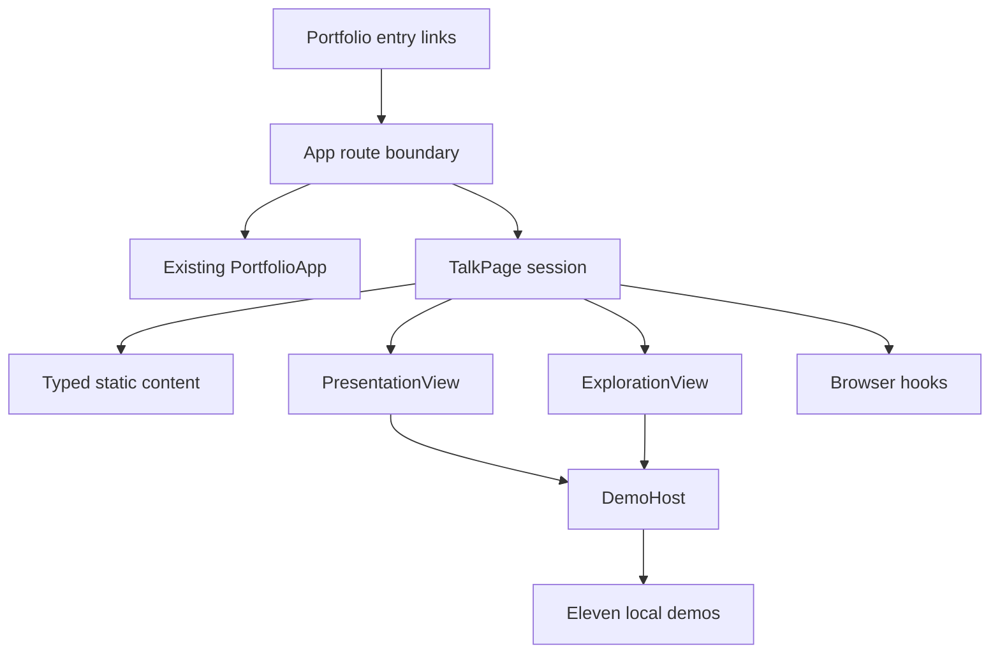

# NUS Career Talk - Application Design

Status: approved by explicit user response “approve” on 2026-10-18.

## Decision summary

Use an App-level, lazy-loaded talk route above PortfolioApp, in-memory TalkPage state, separately editable typed Vietnamese content, presentation/exploration views and eleven locally stateful demo components. Keep the current provider and stored portfolio preferences. The talk is its own page, not a third portfolio theme.

On return, remount the portfolio at its remembered valid section/journal hash; a direct talk visit returns to home. Talk-specific slide/mode state lasts for the mounted visit. Shared talk links in both templates import only lightweight route metadata.

## Completeness and traceability

| Obligations | Design ownership |
| --- | --- |
| US01 / FR8 | App route boundary and both desktop/mobile headers; remembered return destination and stored preferences. |
| US02 / FR5 | Session controller, PresentationView/Controls and browser hooks. |
| US03 / FR1–FR2 | Comparison scene, typed Vietnamese content and text-equivalent visual. |
| US04 / FR3–FR4 | Focus map, eleven area content records and official source metadata. |
| US05 / M01–M03 | Featured scenes and distinct Algorithms, AI and Graphics demos. |
| US06 / FR4 / M01–M11 | ExplorationView, FocusAreaDetails, DemoHost and all eleven field components. |
| US07 / FR6 | TalkPage mode, selected area and preserved slide position. |
| US08 / NFR1–NFR3 | Semantic views, motion/focus/keyboard hooks, active-demo lifecycle and scoped styles. |
| US09 / FR7 | Closing scene, reflection challenge, exploration and reference actions. |
| NFR4 | Static local data, browser-feature fallbacks, existing GitHub Pages base path. |
| NFR5 | Typed content/IDs, callback boundaries, scoped listeners and styling. |

Every FR1–FR8, NFR1–NFR5, US01–US09 and demo scenario M01–M11 has an owner. Detailed schemas, computations and state-transition rules follow in Functional Design; measurable accessibility/performance criteria and lifecycle patterns follow in NFR Requirements/Design. No unresolved product ambiguity blocks this high-level design. These later stages are deliberately not treated as completed.

## Validation limits

Reviewed current App, shells and layout-hook boundaries. Validated simple Mermaid declarations/edge targets and Markdown table structure; provided a text alternative. This is design documentation only: no application code changed, no runtime checks or visual QA performed.

## Extension compliance

Security Baseline and Property-Based Testing: N/A; both explicitly disabled in state (Q7 B, Q8 C). Full rules skipped. No enabled extension has a blocking finding.

## Consolidated artifact contents

### components.md

## Components

### Route boundary - existing App

Own browser hash subscription to hashchange and popstate; select the existing exported PortfolioApp or a lazy-loaded TalkPage. Resolve the exact talk hash `#/talks/nus-cs` before mounting portfolio layout hooks. Render an accessible loading fallback while loading the feature. Retain the most recent non-talk hash in memory for the return action; direct talk visits fall back to portfolio home. Route recognition does not introduce a third portfolio template or a new SectionId.

Mount only one experience at a time. Portfolio template, layout and colour preferences remain owned by existing storage/provider mechanisms; talk state is not written into those keys. Returning remounts the existing portfolio at the chosen hash. Session-only state such as an open drawer need not survive leaving the portfolio.

### TalkPage and session controller

Own mode, slide position, selected focus area and motion pause preference for the mounted talk visit. Pass state and callbacks to both views. Preserve slide position when exploring; select a featured slide's area on entering exploration. Browser return contract is received from App. TalkPage owns its Vietnamese language scope and talk-specific styles.

### PresentationView and PresentationControls

Render the approximately twelve-minute narrative: opening, speaker introduction with the portfolio photo, CS/CE comparison, NUS CS introduction, eleven-area overview, three featured demos, and closing. Controls expose previous/next, progress, exploration, fullscreen and exit. Render only the current teaching scene and its active demo. NUS sources remain accessible without requiring a dense projection slide.

### ExplorationView and FocusAreaDetails

Show all eleven area choices, selected Vietnamese explanation, English name, application, interest connection, careers, sources and one active demo. Provide a clear return to presentation. Fields not featured in the live sequence remain fully explorable.

### TalkContent and types

Static typed data, independent of rendering: stable field/slide IDs, Vietnamese narrative, area metadata, illustrative jobs, references and verification dates. Content is separately editable. Validate completeness for all eleven fields. NUS factual content is checked against official pages before finalisation.

### DemoHost and eleven demo components

Map stable area IDs to distinct components corresponding to M01–M11. Each component receives motion policy and owns its local inputs, steps, computed output and reset/replay. Shared diagram/text/control primitives are allowed; substantive outcomes remain distinct. Unmount inactive demos. Exact computation and reset rules belong to Functional Design.

The eleven components cover route optimisation, toy classification, lighting/viewpoint, protected message representation, indexed lookup, interface task flow, similarity retrieval, packet routing/failure, worker scheduling, expression evaluation and test/release workflow.

### Browser interaction hooks

Talk-scoped hooks own keyboard filtering, focus transitions, fullscreen state/events and reduced-motion preference. Listeners and animation resources are disposed on unmount. Browser feature absence is a supported state, not a route failure.

### Portfolio entry links

Engineering: `src/components/Navbar.tsx`. Business: `src/templates/business/BusinessShell.tsx`. Share the talk hash/link metadata through a small route constant module that does not import the talk feature. Expose links on desktop and mobile; close a mobile drawer when following its link.

### Extension compliance

Security Baseline and Property-Based Testing: N/A; both explicitly disabled in state (Q7 B, Q8 C). Full rules skipped. No enabled extension has a blocking finding.

### component-methods.md

## Component Methods and Interfaces

These are conceptual TypeScript signatures, not implementation files. Names may be refined during coding while preserving responsibilities. Exact schemas and transition logic follow in Functional Design.

### Route contract

- `isNusTalkHash(hash: string): boolean`: recognise the dedicated exact talk route.
- `getPortfolioReturnHash(lastPortfolioHash?: string): string`: return the last known portfolio destination or a safe home fallback. Only valid local portfolio section/journal hashes qualify.
- `navigateToHash(hash: string): void`: change browser history and notify the route boundary consistently with existing browser behaviour.
- `TalkPage(props: { onExit: () => void }): ReactElement`: lazy feature entry receiving an explicit return action.

App subscribes to hashchange and popstate; the same route decision must apply on direct load, native anchor changes and history navigation. An unknown hash retains existing portfolio fallback behaviour.

### Talk session contract

- `TalkMode`: presentation or exploration.
- `FocusAreaId`: finite union of eleven stable area IDs.
- `SlideId`: stable identifier for a narrative scene.
- `TalkSessionState`: mode, current slide ID, selected area ID and manual motion-pause flag.
- `goToSlide(slideId: SlideId): void`: select a valid scene.
- `previousSlide(): void`, `nextSlide(): void`: bounded narrative navigation.
- `openExploration(areaId?: FocusAreaId): void`: select a meaningful area and change view while preserving slide position.
- `resumePresentation(): void`: restore the retained narrative scene.
- `selectArea(areaId: FocusAreaId): void`: choose exploration details and active demo.
- `setMotionPaused(paused: boolean): void`: control continuous animation without hiding explanations.

### View and data contracts

- `PresentationView({ slide, onExplore, motionPolicy })`: display a scene with optional featured demo.
- `PresentationControls({ progress, canGoBack, canGoNext, onPrevious, onNext, onExplore, fullscreen, onExit })`: accessible navigation surface.
- `ExplorationView({ selectedAreaId, onSelectArea, onResume, motionPolicy })`: field navigation and selected detail view.
- `FocusAreaDetails({ area, motionPolicy })`: explanatory content, illustrative careers, sources and demo.
- `FocusAreaContent`: stable ID, official English name, Vietnamese name/explanation, application, interest connection, at least two illustrative careers, accent identity and source references.
- `SlideContent`: stable ID, scene kind, Vietnamese heading/body and optional focus-area ID.
- `SourceReference`: title, official URL and verification date.

### Demo contracts

- `DemoHost({ areaId, motionPolicy }): ReactElement`: resolve the matching field component.
- `MotionPolicy`: whether continuous movement is allowed, based on preference and manual pause.
- Each demo owns `reset(): void` and meaningful local input actions; replay/step/run controls are exposed only where appropriate.
- Textual result/explanation is part of the demo output contract, including under paused/reduced motion.

### Browser contracts

- `useTalkKeyboard({ enabled, onPrevious, onNext }): void`: scoped listener that leaves editable and interactive input keys available.
- `useTalkFullscreen(targetRef)`: supported/active state, status message and async toggle action with handled rejection.
- `useTalkMotion()`: preference state, manual pause setter and resulting motion policy.
- Focus management receives the destination heading/control ref on mode or topic transitions; it does not repeatedly steal focus during an active demo.

No methods call a backend or write student records. These interfaces do not prescribe algorithms or add capabilities beyond the approved requirements.

### Extension compliance

Security Baseline and Property-Based Testing: N/A; both explicitly disabled in state (Q7 B, Q8 C). Full rules skipped. No enabled extension has a blocking finding.

### services.md

## Services and Orchestration

### Client-only orchestration

No server or service layer is introduced. React state and small browser hooks coordinate the feature. Static content and local toy computations provide all required teaching behaviour.

### Route coordination

App reads the current hash and subscribes to browser navigation. It chooses one mounted experience: PortfolioApp or lazy TalkPage. Browser history remains authoritative. App remembers the last valid non-talk portfolio hash for the return callback; direct visits return to home. Existing provider/storage mechanisms retain colour, template and layout preferences across the portfolio remount.

Avoid mounting portfolio layout/scroll machinery inside the talk. The inspected `usePortfolioLayout` currently normalises only one-segment section hashes; an App-level boundary further separates lifecycles rather than teaching that hook about talk slides.

### Presentation coordination

TalkPage's session controller drives slide progress, exploration mode and selected field. PresentationView and ExplorationView emit callbacks; neither rewrites browser history for every interaction. Internal slide/topic state is in-memory during the mounted visit; persistent deep links to individual slides and cross-visit demo persistence are outside the approved scope.

On exploration entry, keep the presentation position and select the relevant field where applicable. On resume, return to the preserved position. Demo state can reset on unmount; that does not discard the required topic/slide context.

### Demo orchestration

DemoHost mounts one chosen field component. Each component owns its toy data/inputs and output and provides explanation and relevant reset/replay actions. It does not mutate session navigation or portfolio preferences. Shared motion policy passes down from TalkPage. Exact data transformations and invariant checks are deferred to Functional Design.

### Browser lifecycle and fallback

The talk scope owns keyboard, focus, media-query and fullscreen listeners. Hooks clean up on exit/unmount, including React StrictMode setup/cleanup cycles. Unsupported/rejected fullscreen leaves normal presentation working; external fullscreen exit updates controls. Reduced/paused motion retains text and final/stepwise results. Asynchronous lazy loading has a readable fallback; load failure handling is defined in NFR Design.

### Content/source responsibility

Store source links and verification dates beside content. Finalise programme claims using official NUS references; keep career mappings illustrative and personal speaker claims absent unless supplied. No runtime content-fetch service, analytics, authentication or live AI inference is required.

### Extension compliance

Security Baseline and Property-Based Testing: N/A; both explicitly disabled in state (Q7 B, Q8 C). Full rules skipped. No enabled extension has a blocking finding.

### component-dependency.md

## Component Dependencies and Communication

| Consumer | Dependency | Communication |
| --- | --- | --- |
| App route boundary | Hash constants, browser history, lazy TalkPage, existing PortfolioApp | Browser subscriptions; route selection; return callback. |
| Portfolio headers | Shared route/link metadata | Native local anchor; drawer close callback where applicable. |
| TalkPage | Typed content, session state, views, browser hooks | Props down, explicit callbacks up. |
| PresentationView | Scene content, controls, optional DemoHost | Bounded navigation and exploration callbacks. |
| ExplorationView | Area content, FocusAreaDetails | Area selection and resume callbacks. |
| FocusAreaDetails | Area metadata, DemoHost | Read-only data and motion policy. |
| DemoHost | Area-to-component registry | Stable ID resolves one active component. |
| Eleven demos | Local data/logic and shared visual primitives | Local state; no global navigation/storage mutation. |
| Browser hooks | Browser feature APIs | Talk-scoped setup, state notification and cleanup. |

Text alternative: portfolio links lead to App's route boundary. App mounts either the existing portfolio or TalkPage. TalkPage coordinates static content, presentation, exploration and browser hooks. Both views use DemoHost for the selected field, which mounts one of eleven local demos. User actions flow back through callbacks; the arrows describe dependencies rather than a separate network service.

### Coupling constraints

Static content/types and route constants must not import demo rendering code. Header imports must not eagerly import the full talk bundle. Demo modules must not import portfolio shells. Browser history is owned at the route boundary; slide/topic selection is local session state. No new third template or portfolio SectionId is introduced.

### Extension compliance

Security Baseline and Property-Based Testing: N/A; both explicitly disabled in state (Q7 B, Q8 C). Full rules skipped. No enabled extension has a blocking finding.

