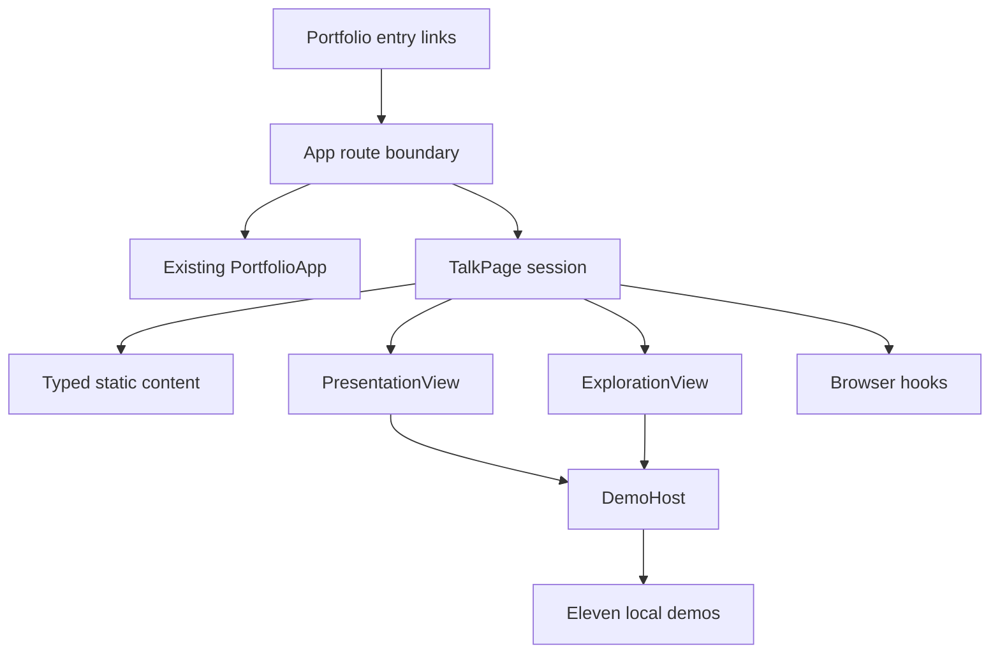

# Component Dependencies and Communication

| Consumer | Dependency | Communication |
| --- | --- | --- |
| App route boundary | Hash constants, browser history, lazy TalkPage, existing PortfolioApp | Browser subscriptions; route selection; return callback. |
| Portfolio headers | Shared route/link metadata | Native local anchor; drawer close callback where applicable. |
| TalkPage | Typed content, session state, views, browser hooks | Props down, explicit callbacks up. |
| PresentationView | Scene content, controls, optional DemoHost | Bounded navigation and exploration callbacks. |
| ExplorationView | Area content, FocusAreaDetails | Area selection and resume callbacks. |
| FocusAreaDetails | Area metadata, DemoHost | Read-only data and motion policy. |
| DemoHost | Area-to-component registry | Stable ID resolves one active component. |
| Eleven demos | Local data/logic and shared visual primitives | Local state; no global navigation/storage mutation. |
| Browser hooks | Browser feature APIs | Talk-scoped setup, state notification and cleanup. |

Text alternative: portfolio links lead to App's route boundary. App mounts either the existing portfolio or TalkPage. TalkPage coordinates static content, presentation, exploration and browser hooks. Both views use DemoHost for the selected field, which mounts one of eleven local demos. User actions flow back through callbacks; the arrows describe dependencies rather than a separate network service.

## Coupling constraints

Static content/types and route constants must not import demo rendering code. Header imports must not eagerly import the full talk bundle. Demo modules must not import portfolio shells. Browser history is owned at the route boundary; slide/topic selection is local session state. No new third template or portfolio SectionId is introduced.

## Extension compliance

Security Baseline and Property-Based Testing: N/A; both explicitly disabled in state (Q7 B, Q8 C). Full rules skipped. No enabled extension has a blocking finding.
