# NUS Career Talk - Execution Plan

Status: approved by explicit user response “approve” on 2026-10-18. Requirements and generated stories/personas are approved.

## Basis

Existing single-package React/TypeScript/Vite portfolio, refreshed architecture, approved Vietnamese 10–15 minute presentation requirements, two personas, nine stories and eleven demo acceptance scenarios. Use the existing GitHub Pages hosting and hash navigation.

## Detailed scope and impact

Transformation: additive application feature, not a hosting or framework migration. Risk: medium, because routing, shared headers, event handling and animation affect an existing portfolio. Rollback complexity: moderate; the talk files and its App/header integration can be reverted together without data migration. Verification complexity: moderate, combining behaviour checks with visual/content review.

- User-facing impact: dedicated presentation and exploration experience, eleven demos, links from both templates.
- Structural impact: a separately organised talk feature with its own content, controls, demo modules and scoped styles; App gains a route integration point.
- Data impact: new typed static talk/area metadata and local demo state; no persistent student data or database schema.
- API impact: internal component/data contracts only; no network endpoints.
- NFR impact: keyboard/focus behaviour, reduced motion, projector/mobile readability, lazy loading, inactive-demo lifecycle and style isolation.

## Component relationships and changes

| Component | Change and priority | Dependencies |
| --- | --- | --- |
| Talk content/types | Add Vietnamese narrative, eleven area entries and source metadata; critical. | Official NUS references; approved requirements. |
| Talk views and controls | Add presentation, exploration and view/topic state; critical. | Content and component contracts. |
| Eleven demo modules | Add distinct bounded teaching interactions; critical. | Area IDs, demo state/output rules and visual primitives. |
| App route | Add talk route and history-aware integration; critical. | Talk entry component; existing hash routing. |
| Engineering and Business headers | Add discoverable desktop/mobile entry links; important. | Stable talk hash; existing responsive navigation. |
| Tests | Add focused interaction/integration checks and run existing regressions; critical. | Observable story outcomes; current Vitest setup. |
| GitHub Pages configuration | Retain existing configuration; verify build/base path. | Existing Vite build and deployment workflow. |

Dependency direction: App and header links lead to the talk entry; talk views use shared content and demo contracts; demo modules expose local interactions. Application Design will finalise the boundaries. No extra package or service is required by this plan. Choose existing/native visual techniques unless a demonstrated requirement justifies a dependency.

## Stages and depth

Six remaining execution stages are recommended, plus the mandatory review of this workflow plan. Code Generation contains its own planning and generation parts.

| Stage | Decision | Depth and rationale |
| --- | --- | --- |
| Workspace Detection | Completed | Existing application and hosting identified. |
| Reverse Engineering | Completed and approved | Stale architecture refreshed. |
| Requirements Analysis | Completed and approved | Standard; scope and extension choices settled. |
| User Stories | Completed and approved | Standard; two personas, nine journeys and eleven demo scenarios. |
| Workflow Planning | Approved | Standard; integration and stage decisions documented here. |
| Application Design | Execute | Standard; define new components, methods, responsibilities and dependencies. |
| Units Generation | Skip | One cohesive feature in one application; no independent service/module delivery requires separate work units. |
| Functional Design | Execute for nus-career-talk | Standard; specify typed static models, view/slide state transitions and distinct demo input/output/reset behaviour. |
| NFR Requirements | Execute for nus-career-talk | Focused; turn approved accessibility, performance, readability and reliability goals into reviewable criteria. |
| NFR Design | Execute for nus-career-talk | Focused; define motion/focus handling, lazy loading, lifecycle cleanup, fallback and style isolation patterns. |
| Infrastructure Design | Skip | Existing static hosting is sufficient; no new cloud resources or deployment architecture. |
| Code Generation | Execute for nus-career-talk | Standard; first approve a checkbox plan, then implement the page, content, integration and relevant checks. |
| Build and Test | Execute after implementation | Build, meaningful functional/regression checks, content and visual QA; create required build/test instruction artifacts. |
| Operations | Placeholder | No active operations stage in the supplied workflow. |

The single unit is `nus-career-talk`: content, controls, views, all eleven demos and existing-site integration. Demo scenarios are verification slices within the unit, not separate approval units.

## Workflow visualisation

```mermaid
flowchart TD
    WD["Workspace Detection - completed"]
    RE["Reverse Engineering - completed"]
    RA["Requirements - approved"]
    US["User Stories - approved"]
    WP["Workflow Planning - approved"]
    AD["Application Design - EXECUTE"]
    UG["Units Generation - SKIP"]
    FD["Functional Design - EXECUTE"]
    NR["NFR Requirements - EXECUTE"]
    ND["NFR Design - EXECUTE"]
    ID["Infrastructure Design - SKIP"]
    CG["Code Generation - EXECUTE"]
    BT["Build and Test - EXECUTE"]
    OP["Operations - PLACEHOLDER"]
    WD --> RE
    RE --> RA
    RA --> US
    US --> WP
    WP --> AD
    AD --> UG
    UG --> FD
    FD --> NR
    NR --> ND
    ND --> ID
    ID --> CG
    CG --> BT
    BT --> OP
    style WD fill:#4CAF50,stroke:#1B5E20,stroke-width:3px,color:#fff
    style RE fill:#4CAF50,stroke:#1B5E20,stroke-width:3px,color:#fff
    style RA fill:#4CAF50,stroke:#1B5E20,stroke-width:3px,color:#fff
    style US fill:#4CAF50,stroke:#1B5E20,stroke-width:3px,color:#fff
    style WP fill:#4CAF50,stroke:#1B5E20,stroke-width:3px,color:#fff
    style AD fill:#FFA726,stroke:#E65100,stroke-width:3px,stroke-dasharray:5 5,color:#000
    style UG fill:#BDBDBD,stroke:#424242,stroke-width:2px,stroke-dasharray:5 5,color:#000
    style FD fill:#FFA726,stroke:#E65100,stroke-width:3px,stroke-dasharray:5 5,color:#000
    style NR fill:#FFA726,stroke:#E65100,stroke-width:3px,stroke-dasharray:5 5,color:#000
    style ND fill:#FFA726,stroke:#E65100,stroke-width:3px,stroke-dasharray:5 5,color:#000
    style ID fill:#BDBDBD,stroke:#424242,stroke-width:2px,stroke-dasharray:5 5,color:#000
    style CG fill:#4CAF50,stroke:#1B5E20,stroke-width:3px,color:#fff
    style BT fill:#4CAF50,stroke:#1B5E20,stroke-width:3px,color:#fff
    style OP fill:#BDBDBD,stroke:#424242,stroke-width:2px,stroke-dasharray:5 5,color:#000
    linkStyle default stroke:#333,stroke-width:2px
```

Text alternative: completed Workspace Detection, Reverse Engineering, Requirements and User Stories lead to this Workflow Planning review. After approval: Application Design; skip separate Units Generation; Functional Design; NFR Requirements; NFR Design; skip Infrastructure Design; Code Generation planning and generation; Build and Test; Operations placeholder. Skipped nodes show decisions, not work that must be executed.

## Package change sequence

One application package, implemented sequentially within the approved unit:

1. Confirm official NUS degree/focus-area references and cohort qualifications; define content and stable area IDs.
2. Establish typed content/demo contracts and the reusable presentation/exploration frame.
3. Implement the eleven visual interactions against their distinct matrix outcomes, including text explanations and resets.
4. Integrate the talk hash route and both headers, preserving existing portfolio routes/preferences.
5. Verify controls, view/topic context, demos, motion/focus, history and fullscreen fallback, then run the existing regression suite and production build.
6. Inspect representative projector/desktop and mobile layouts when browser tooling is available; record limitations and rehearse the short narrative.

These steps are sequencing guidance, not permission to begin code before the Code Generation plan is approved. All work is local until the relevant publishing workflow is reached. No parallel agent work is proposed.

## Verification and risk controls

- Route regressions: direct opening/refresh, back/forward, return, both templates and journal/section navigation.
- Demo correctness: each M01–M11 input changes a meaningful output; simplified assumptions and careers remain clearly labelled; test algorithm/state behaviour where it can fail.
- Accessibility: arrow keys remain available to demo inputs, focus stays on visible content, motion can be reduced/paused, colours have accompanying labels.
- Runtime isolation: inactive visual work stops, listeners are cleaned up and talk styles do not affect the portfolio.
- Educational accuracy: official NUS sources support programme claims; Vietnamese explanations avoid jargon and career guarantees.
- Performance: inspect production chunking and avoid loading active demo work into the initial portfolio unnecessarily; do not invent unmeasured speed claims.
- Visual QA: assess clipped content, mobile controls and projection legibility; unsupported browser tooling is a reported verification limit.

Planned automated checks: focused Vitest/Testing Library behaviour tests, existing regression suite and `npm run build`. No tests have been run for this planning-only change. Manual rehearsal assesses the 10–15 minute goal.

## Deliverables and success criteria

Working `#/talks/nus-cs` page with both entry links; Vietnamese CS/CE comparison and NUS focus overview; three featured live demos; all eleven independently explorable application/career demos; inspiring closing challenge; keyboard/fullscreen/motion controls; verified static build; documented test and visual-review results.

All US01–US09, M01–M11 and FR1–FR8/NFR1–NFR5 must be accounted for. No new backend, account, live AI, admissions/salary guidance or presentation export is introduced.

## Timeline

Six execution stages remain after this plan's approval. Duration depends on design review and visual/demo iterations; no unsupported calendar estimate is committed. The 10–15 minute requirement concerns the talk itself.

## Progress checklist

- [x] Record generated-story approval and complete story-plan tracking.
- [x] Load prior artifacts and analyse component impact, dependencies and risk.
- [x] Select one unit, stage decisions and adaptive depths.
- [x] Validate workflow diagram structure and provide a text alternative.
- [x] Generate execution plan and review question; update state and audit.
- [x] Receive execution-plan approval.
- [x] Application Design.
- [x] Functional Design for nus-career-talk.
- [x] NFR Requirements for nus-career-talk.
- [x] NFR Design for nus-career-talk.
- [x] Code Generation Part 1 plan approval.
- [x] Code Generation Part 2 implementation and review.
  - [x] Implemented and verified; 114 tests and production build passed.
  - [x] Generated-code approval.
- [x] Build and Test with instruction artifacts and results.
- [x] Approve results and proceed to Operations placeholder.

Skipped: Units Generation and Infrastructure Design. Operations remains a placeholder. Each executed stage must load its own rule details and follow its explicit review gate.

## Extension compliance

| Extension | Enabled | Assessment |
| --- | --- | --- |
| Security Baseline | No, Q7 B | N/A; disabled, full rules skipped. |
| Property-Based Testing | No, Q8 C | N/A; disabled, full rules skipped. |

No enabled extension has a blocking finding. Ordinary approved correctness/accessibility obligations remain in scope.

## User control

The recommendations are adjustable: request changes, add a skipped stage, or approve and continue to Application Design. Record the choice in `nus-career-talk-execution-plan-review-questions.md`.
