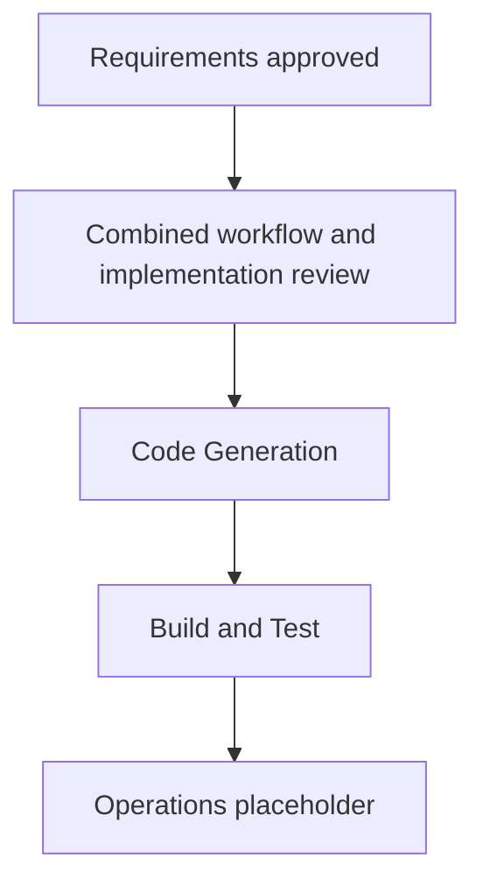

# Header and Photo Introduction - Focused Execution Plan

Status: combined plan approved; implementation and verification complete; generated-code review pending.

## Scope, impact and risk

Single existing `nus-career-talk` unit. Fix header crowding, insert a CV-backed introduction with existing portrait as the second scene, and replace fixed slide indexes/bounds with content-driven navigation. No new package, route, service, data persistence or infrastructure. Risk is low to moderate: responsive headers and slide-context regressions need checks.

Dependencies: current headers, shared profile photo, talk content/models/views and existing test/build tools. Preserve existing uncommitted work; edit only the amendment's source and supporting documentation. Original eleven demos and all other content retain their current contracts.

## Story amendment for review

Reuse the approved presenter/student personas and journey-based story format.

**US10 - Meet the speaker.** As a high-school student, I want a short introduction to the speaker and their experience so that I understand the perspective behind the career talk.

- Given the opening, when I advance, then the second slide shows Nham Quoc Hung, the existing portfolio portrait and the approved concise Vietnamese CV highlights.
- Given the UT Austin study entry, when it appears, then it is ongoing according to the CV, not described as a completed degree.
- Given phone or projection layout, when I read the slide, then portrait and text remain legible without stretching the photo or clipping key information.
- Given the new slide, when I navigate to featured demos and exploration, then the same field and previous presentation position are preserved.

US01 adds header acceptance: NUS CS and arrow stay on one line with reserved width/padding; compact navigation takes over before crowding. US02/US07 now cover ten content-driven narrative positions. R1–R3 map to US01/US02/US07/US10. Existing NFR1–NFR5 remain in force.

## Adaptive stage decisions

- Workspace Detection: complete; same brownfield application.
- Reverse Engineering: reuse current application-design/source context; no system-wide rerun.
- Requirements: complete and approved.
- User Stories: reuse approved methodology/personas and review the bounded US10/acceptance amendment above with this plan; no new story-methodology questions needed.
- Workflow Planning: execute here.
- Application Design, Units Generation, Functional/NFR Requirements/NFR Design: reuse existing approved boundaries, single unit, typed-content contracts and quality requirements. No new component service/model family or new NFR pattern needs a separate design stage; the content-driven navigation adjustment is explicitly covered by R3 and the implementation plan.
- Infrastructure Design: skip; hosting unchanged.
- Code Generation: execute numbered implementation plan after explicit approval.
- Build and Test: execute focused/full regression, production build and responsive browser inspection; update existing scoped instructions/results rather than duplicate them.
- Operations: existing placeholder only; no commit/push/publication in scope.

## Workflow visualisation

Text alternative: approved amendment requirements lead to this combined plan review, then source changes, verification and the existing Operations placeholder. The stage decisions above identify which existing stages are reused or skipped.

## Update sequence and success criteria

Follow the exact numbered sequence in `aidlc-docs/construction/plans/nus-career-talk-header-intro-code-generation-plan.md`. One package, sequential edits. A successful amendment has a comfortable header at 360/1110/1280/1440/wide widths, a sourced photo introduction second in a ten-scene talk, unchanged eleven demos, correct topic retention, passing checks and documented verification limits. No unsupported duration estimate is committed.

## Progress

- [x] Record requirements approval and review existing architecture/stories/source.
- [x] Define focused story amendment, stage decisions and verification approach.
- [x] Prepare explicit numbered code-generation plan for joint review.
- [x] Receive explicit combined approval of workflow, story amendment and complete code-generation sequence.
- [x] Implement approved changes and verify.
- [x] Present generated-code review.
- [ ] Receive generated-code approval before formal Build and Test.

## Extension compliance and user control

Security Baseline and PBT: N/A, explicitly disabled; full rules skipped. No enabled blocking findings. Request changes or add a reused/skipped stage if desired; approval covers only the concrete plan and scope linked above.
