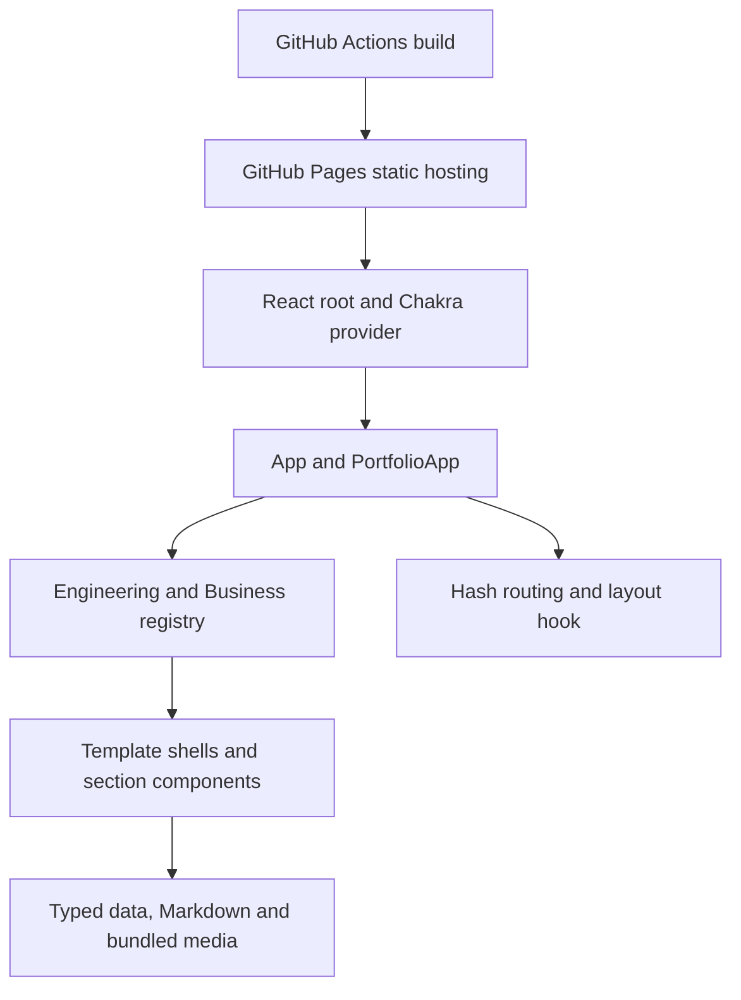

# System Architecture

One React 19/TypeScript client application is built by Vite and served by GitHub Pages. No backend, database, authentication or runtime API exists.

Text alternative: the provider mounts App; App resolves the template and hash/layout state; shells render components using shared content. Actions builds the static files for Pages.

## Boundaries

- App owns browser hash, active template, local journal resolution and visible sections.
- Templates supply shells, journal pages, chapter labels, complete section maps and optional section visibility predicates.
- Browser storage persists template, layout and colour preferences.
- History, hashchange and popstate coordinate navigation; deep links use hashes to avoid server rewrites.
- External integrations are links, email-client actions and media embeds rather than application services.

## Proposed feature integration seam

A dedicated presentation route can branch from App while retaining the existing portfolio. Route style and entry point require requirements approval. No presentation route exists yet.
