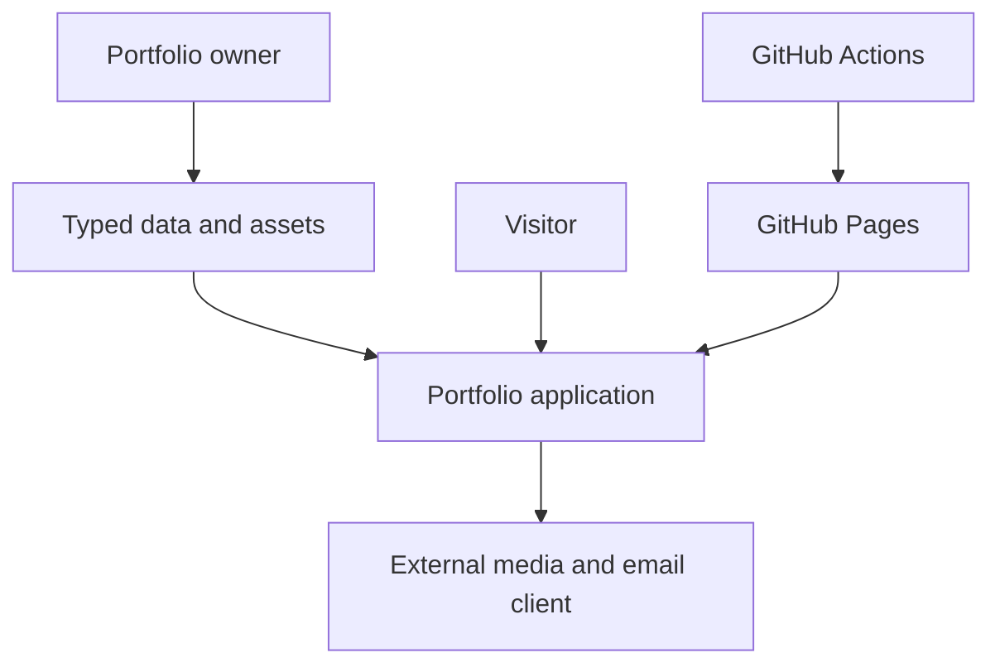

# Business Overview

The website presents a student's profile, education, experience, awards, projects, gallery, writing, skills, certificates and contact options. One static application supports Engineering and Business presentations over shared typed content.

## Business transactions

- Owner edits TypeScript data, Markdown posts and bundled assets.
- Visitor selects Engineering or Business; browser storage remembers the choice.
- Visitor browses continuous sections or hash-routed section pages.
- Visitor opens local journal posts, external writing, media previews, certificates and resume downloads.
- Visitor prepares an email using the contact form and their email client.
- Owner publishes through the existing GitHub Actions/GitHub Pages workflow.

## Business dictionary and ownership

A template supplies a shell and section components. A section is a typed portfolio content area. A journal post is local Markdown addressed by slug. App owns template and route state; templates present shared data; GitHub Pages serves the built files.

## Interaction diagram

Text alternative: the owner maintains content, Actions builds and publishes it, and visitors browse the application and follow external actions.
